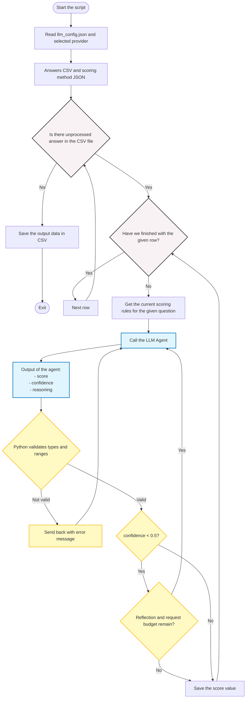

<center><h1>Interview answer scoring system</h1></center>

Notebooks: [Local / Jupyter](interview_scoring_system.ipynb) |
[Colab version](Interview_answer_scoring_system-colab_version.ipynb).
The [external Kaggle copy](https://www.kaggle.com/code/sndorburian/interview-answer-scoring-system)
is not automatically synchronized with these repository notebooks.

This is a tool to give score values to text-based answers from interviews. This is useful in the evaluation of surveys.

The goal of this scirpt is to make it possible to evaluate several answers with statistical methods, converting the text to numeric values in specidic ranges.

The script evaluates each interview answer against a question-specific rubric
and requests a numeric score, reasoning, and confidence. Python validates every
accepted output. Low-confidence results receive a bounded re-evaluation and
retain genuine uncertainty for human review; confidence is not forced upward.
LLM scoring is not guaranteed to be deterministic or accurate and should be
checked against a human-scored reference sample.

## How-to

Requirements:

- [Python 3.11+](https://www.python.org/)
- A running local OpenAI-compatible server, or an API key for the selected
  [Gemini](https://aistudio.google.com/api-keys), Mistral, Groq, or OpenRouter provider.

### 1. Activate Virtual Environment

PowerShell:
```
py -m venv .venv; . .\.venv\Scripts\Activate.ps1
```

or

```powershell
.\.venv\Scripts\Activate.ps1
```

If needed (temporary for current shell only):

```powershell
Set-ExecutionPolicy -Scope Process -ExecutionPolicy Bypass
```

### 2. Install Dependencies
```shell
pip install -r requirements.txt
```

or manually

```powershell
pip install google-genai
pip install pandas
```

### 3. Choose the backend in JSON

Edit `llm_config.json`. Change `"provider"` to `local`, `gemini`,
`mistral_free`, `groq_free`, or `openrouter`. The shipped configuration selects
`local`, the example input `tests/results/test.csv`, and `evaluation.json`.
Set `input_csv` to your own dataset before processing real interviews.

For cloud providers, put the API key in the matching file: `gemini.key`,
`mistral.key`, `groq.key`, or `openrouter.key`. Each file contains only the key.
These files are ignored by Git. Environment variables are also supported and
take priority over the selected key file. Never put keys in the JSON or README.

### 4. Run the Agent

```powershell
python .\app.py
```

For another JSON configuration, use `python app.py --config my_config.json`.
Relative input, output, and key-file paths are resolved relative to that config
file. JSON configuration takes priority over the legacy `LLM_PROVIDER` and
`LOCAL_LLM_*` environment settings.

See [HUN_CONFIGURATION.md](HUN_CONFIGURATION.md) for the full Hungarian setup guide,
security limitations, and examples. JSON is machine-readable;

### Notebooks

Both repository notebooks use the same `llm_config.json`, provider profiles,
key-file/environment lookup, and scoring implementation as the CLI.
`notebook_support.py` runs `app.py --config ...` in a subprocess and returns
the resulting DataFrame; it does not duplicate or rewrite the scoring code.

- **Local/Jupyter:** open `interview_scoring_system.ipynb` from the repository
  root, install its requirements, edit the JSON, and run the scoring cell.
  Change `CONFIG_PATH` to select a different configuration.
- **Colab:** open `Interview_answer_scoring_system-colab_version.ipynb`. Its
  setup clones the configured repository ref only if no checkout exists; it
  does not reset existing files. While PR #1 is open the default ref is
  `feat/json-llm-provider-config`; after merge change `REPO_REF` to `main`.
- **Colab Secrets:** when the selected cloud provider has no environment/key-file
  credential, only its configured `api_key_env` secret is requested.
  Local mode does not request Secrets. A secret is passed privately to the
  child environment, not stored in notebook source or written to a `.key` file.
- **Results:** request-budget exhaustion returns saved partial results with
  a warning and `result_df.attrs["partial_results"] = True`. Other process
  errors stop execution instead of displaying a stale CSV. Child logs are not
  automatically printed into notebook output; inspect `agent.log` only when
  needed, because it may contain interview data.

No extra `guardrails-ai` installation is needed: `guardrails.py` is part of this
repository. Clear notebook outputs before sharing. Hosted Colab localhost is
not your home computer; use a local notebook/runtime for a home LLM server,
rather than exposing an unauthenticated server publicly.

### Free-tier safeguards

- OpenRouter accepts only `openrouter/free` or explicit `:free` model IDs.
  Requests also restrict prompt and completion prices to zero and disable
  provider fallback, as described in its
  [routing documentation](https://openrouter.ai/docs/guides/routing/provider-selection).
- The Mistral `mistral_free` label selects the Mistral API; it does not change
  the account's subscription. Keep Free mode and pay-as-you-go disabled in the
  [Mistral subscription settings](https://docs.mistral.ai/admin/billing-usage/subscriptions).
- Use a free-tier Groq organization and a Gemini project without paid billing.
  The script cannot change provider billing plans or guarantee that an account
  with billing enabled stays free.
- `max_requests_per_run` counts outbound application requests, including retries
  and reflection. At the cap the program saves partial results and exits with
  code 2; it does not switch provider. This is a per-run cap, not a daily token
  allowance or provider-side billing cap.

Every backend uses the same application-managed validation and bounded
reflection loop. The legacy Gemini tool helpers remain in the source for
reference but are not used by the configured scoring path.

### Local LLM backend (llama.cpp, Ollama, compatible servers)

In `llm_config.json`, select `"provider": "local"` and edit `providers.local`.
Local mode requires no
Gemini key, does not read unrelated provider keys, and never falls back to a cloud provider.
An explicitly configured local server key is supported if needed.
The current shared requirements still install the Google SDK for the Gemini
backend; local mode does not initialize its client or call its API.

For llama.cpp, start a server on an explicitly selected port with an instruct/chat
GGUF model and a matching API model alias:

```shell
llama-server -m /path/to/model.gguf --host 127.0.0.1 --port 8080 --alias interview-scorer
```

Set the matching model alias and base URL in the JSON, then run `python app.py`.
For an already running Ollama server with a downloaded model, use
`http://127.0.0.1:11434/v1` and its exact installed model tag.

### Legacy environment-only setup

The following environment settings apply only when `llm_config.json` is absent
and no `--config` file was requested. In that legacy mode the default provider
is Gemini; only `gemini` and `local` are supported without JSON.

PowerShell:

```powershell
$env:LLM_PROVIDER = "local"
$env:LOCAL_LLM_BASE_URL = "http://127.0.0.1:8080/v1"
$env:LOCAL_LLM_MODEL = "interview-scorer"
python .\app.py
```

Or Bash:

```bash
export LLM_PROVIDER=local
export LOCAL_LLM_BASE_URL=http://127.0.0.1:8080/v1
export LOCAL_LLM_MODEL=interview-scorer
python app.py
```

For an already running Ollama server with a downloaded model, set the base URL
to `http://127.0.0.1:11434/v1` and the model name to its exact installed tag.
Other servers, such as LM Studio or vLLM, can be used when they expose the same
OpenAI-compatible chat-completions contract. Compatibility with each server and
model should be tested before processing a full dataset.

| Environment variable | Default | Purpose |
|---|---|---|
| `LLM_PROVIDER` | `gemini` | Select `gemini` or `local`. |
| `LOCAL_LLM_BASE_URL` | `http://127.0.0.1:8080/v1` | API base URL, including `/v1`, not `/chat/completions`. |
| `LOCAL_LLM_MODEL` | `interview-scorer` | Loaded model tag or server alias. |
| `LOCAL_LLM_API_KEY` | empty | Optional bearer key if your server requires authentication. |
| `LOCAL_LLM_TIMEOUT` | `120` | Per-request timeout in seconds. Slow CPU inference may need a higher value. |
| `LOCAL_LLM_MAX_TOKENS` | `512` | Maximum output tokens per request. |
| `LOCAL_LLM_MAX_ATTEMPTS` | `3` | Total call limit per answer, including corrections and reflection. |
| `LOCAL_LLM_MAX_REFLECTIONS` | `1` | Maximum low-confidence re-evaluations within the total call limit. |
| `LOCAL_LLM_JSON_MODE` | `json_object` | `json_object`, `json_schema`, or `none`, depending on server support. |

Local mode sends `POST <base_url>/chat/completions`, disables inherited HTTP
proxies, and rejects HTTP redirects. No model tool calling is required: Python
always validates the three output fields, finite numeric values, score range,
and confidence range before accepting a result. An uncertain result is
re-evaluated at most once by default, then retained with its honest low confidence
for human review rather than forced above a threshold. These guarantees apply
to all configured backends.

If the server rejects `response_format`, select `LOCAL_LLM_JSON_MODE=none`.
The prompt still requests JSON, and the same mandatory Python validation applies.
This setting is explicit: the application does not silently alter server options.
For connection errors, check the server address and loaded model; for truncated
JSON, consider increasing `LOCAL_LLM_MAX_TOKENS`.

Keep the server bound to `127.0.0.1` unless you deliberately configure a trusted
LAN deployment. `localhost` in Colab/Kaggle refers to the notebook machine, not
your home computer. Both notebooks call the same `app.py` implementation.
The configured server is trusted, so point it only at
an endpoint where you intend to send your interview data. Local inference has
no provider API charge, but still uses your hardware and electricity.

Run the local adapter tests without contacting a real model:

```shell
python -m unittest discover -s tests -v
```

Server protocol references:
[llama.cpp server documentation](https://github.com/ggml-org/llama.cpp/tree/master/tools/server)
and [Ollama OpenAI compatibility](https://docs.ollama.com/api/openai-compatibility).

## Input
1. Survey answer dataset as `csv`
2. The scoring method as a `json`

The survey answers are an input from `csv` file, where the first row's columns are the questions, and every other row is an answer from a person.

The scoring method is a JSON file, where the `questions` list has objects as elements, each object's key parameter is the question's string, the same one as from the `csv` file.


Example structure of the JSON file:
````
{
    "questions": 
    [
        {"question #1": [
            "scoring method, to-dos",
            range_start_value_as_number, range_end_value_as_number]
        }
    ]
}
````

The input can be set next to the script in the same folder, or if the script won't see it, then it will ask for it in the terminal.

Example inputs are [evaluation.json](evaluation.json) and
[tests/results/test.csv](tests/results/test.csv). Explicit `rules_json` and
`input_csv` paths are recommended. With null input paths, discovery ignores
the output CSV and configuration JSON; ambiguous matches cause an error instead
of selecting an arbitrary file.

## The output

The output by default is `scored_answers.csv` and `agent.log`. The structure of the output:
```
respondent_row,question,original_answer,score,confidence,reasoning
```

__________________________________________________________________

## About the script



The shipped JSON selects a local LLM by default. Change its provider field
to select a cloud backend; no source-code edit is necessary.

The answer of the LLM is an object, it hase these parameters:
- score - value between the given range
- confidence - value between 0.0-1.0
- reasoning - the reason of the decision

Validation and reflection are managed by Python for every configured provider.
Model-side tool calling is not required. Invalid outputs and transient failures
consume the configured attempt budget; a run-wide request cap also applies.

The agent get the data one-by one, row by row.
